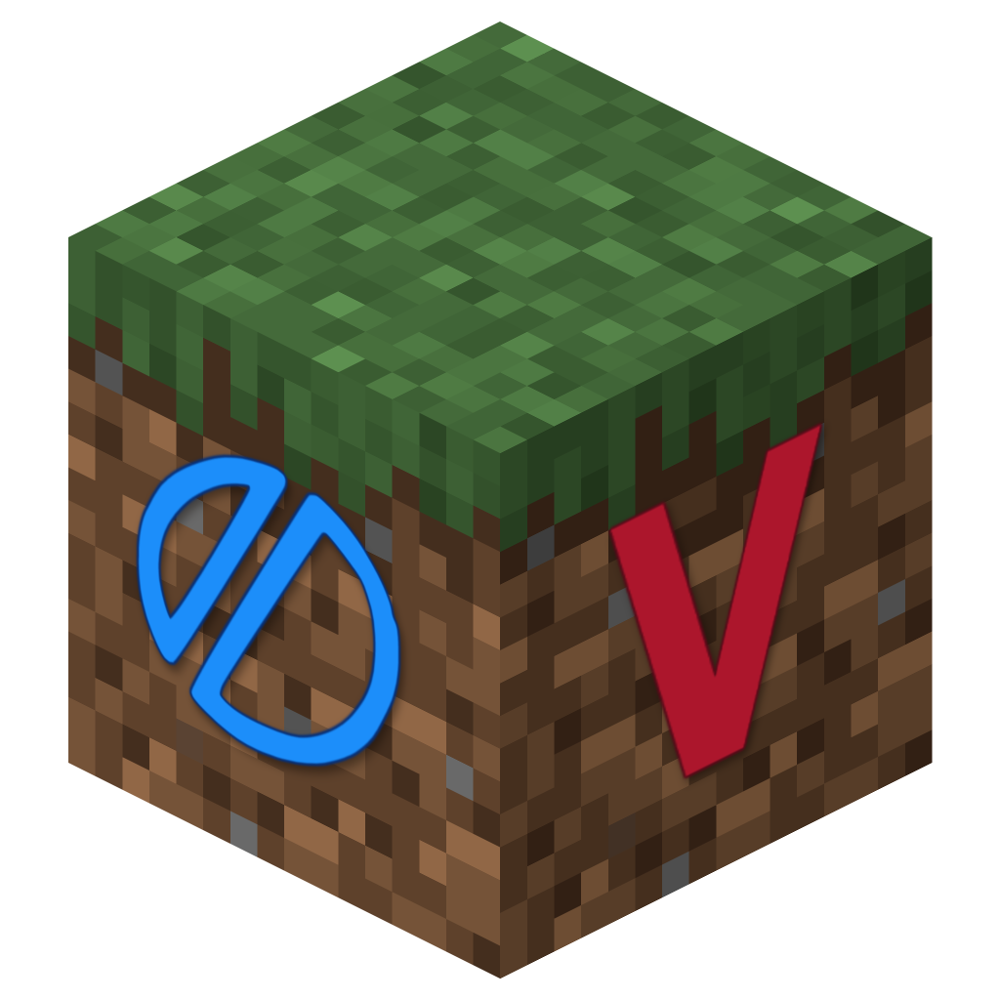

# Vulke

A voxel sandbox tech demo written in Odin and rendered with Vulkan 1.1 — procedural terrain and textures, no engine, ~1200 FPS on an Intel UHD 620.

<p align="center">
  
</p>

Windows only for now.

## Features

- 80×80×16 world (5×5 chunks of 16) generated from a layered sine/cosine height function
- Grass, dirt and stone blocks
- Textures generated at runtime from a hash — no image files in the renderer
- 0.7× render target with a composite upscale pass
- Distance fog with horizon blending and a Minecraft-style vignette
- First-person movement with gravity, sprinting and jumping
- Raycast block targeting (4.5 blocks) with a 2 px outline and an inverting crosshair
- HUD with FPS, position, block/chunk, facing and GPU name

## Controls

| Input | Action |
| --- | --- |
| `WASD` | Move |
| `Shift` | Sprint |
| `Space` | Jump |
| `Mouse` | Look |
| `Left click` | Lock cursor |
| `Esc` | Release cursor |

## Build

Requirements: [Odin](https://odin-lang.org) `dev-2026-10` nightly or newer. No Vulkan SDK is needed to build or run, but a Vulkan 1.1 driver is required at runtime.

```
odin build src -out:vulke.exe -o:speed -resource:assets/vulke.res
```

Or run `build.bat`.

The precompiled shader is committed at `shaders/voxel.spv`. To rebuild it from `shaders/voxel.wgsl`:

```
cd tools/spv
cargo run --release -- ../../shaders/voxel.wgsl ../../shaders/voxel.spv
```

## Status

Tech demo: no block breaking or placing yet. Windows only.
